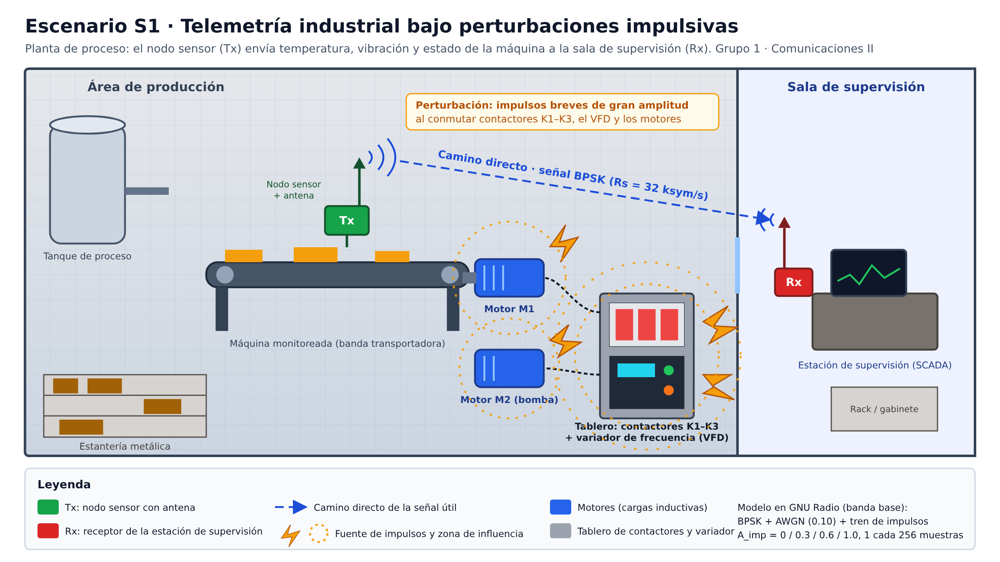
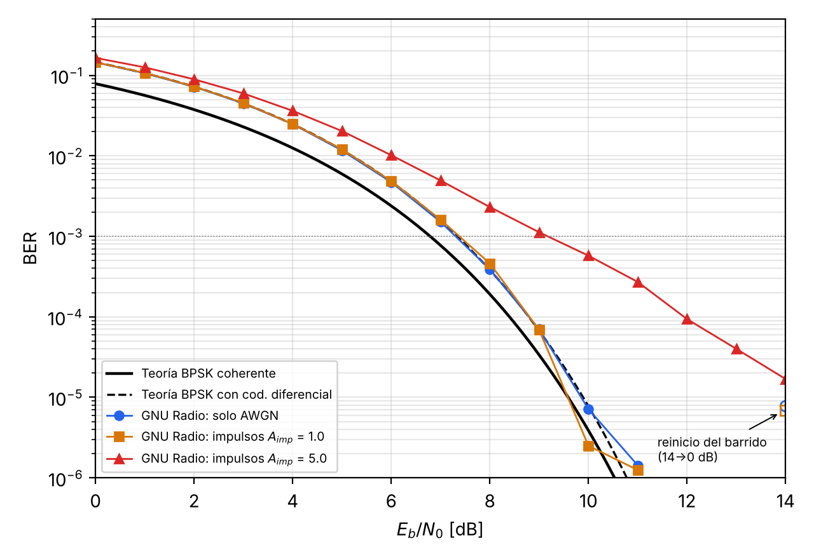

# Enlace BPSK de telemetría industrial bajo ruido impulsivo

**Comunicaciones II (27145), UIS, 2026-2. Grupo 1, escenario S1: telemetría industrial bajo perturbaciones impulsivas.**

**Integrantes:**
- Julian Camilo Acevedo Salamanca
- Luigy Andrey Amado Durán
- Juan Camilo Salazar Ariza

## Resumen

Un nodo de telemetría transmite 32 kb/s desde una banda transportadora hasta la sala de supervisión. Cerca del nodo hay motores, contactores y variadores, que generan ruido impulsivo. Se diseñó un enlace BPSK con conformación RRC y un receptor propio (filtro acoplado, ojo, muestreo, decisión y BER), primero en simulación y luego para HackRF One y USRP. El filtro acoplado reduce cada impulso a 0.100·A_imp en el instante de decisión. Por eso la BER fue cero hasta A_imp = 5 con AWGN de 0.10, aunque el margen bajó de 0.88 a 0.40. Con las curvas BER del instrumento del curso, el enlace necesita 7.30 dB de Eb/N0 para BER = 10⁻³ sin impulsos (la teoría con codificación diferencial da 7.33 dB) y 9.17 dB con A_imp = 5.

## Parámetros

| Parámetro | Valor |
|---|---|
| Modulación | BPSK `(-1, +1)` con codificación diferencial en hardware |
| Rs / Rb | 32 ksym/s / 32 kb/s |
| SPS / fs | 8 / 256 kS/s |
| Filtro | RRC, β = 0.35, span 11 (89 coeficientes), BW = 43.2 kHz |
| Perturbación | AWGN (amplitud 0.10) + tren de impulsos reales de amplitud A_imp, uno cada 256 muestras (1 ms) |
| Hardware | fc = 960 MHz; HackRF One a 2 MS/s (×125/16); USRP a 1 MS/s (×125/32) |

## Flujogramas y cómo ejecutarlos

Se usó GNU Radio 3.10.12. Para ejecutar un flujograma, se abre en GNU Radio Companion y se presiona *Execute* (F6).

| Fase | Archivo | Qué hace |
|---|---|---|
| 1 | `grc/archivos_modificados/fase1_canal/Enlace_Beta_Impulsivo_Grupo1.grc` | Archivo base del curso modificado: BPSK con pulso rectangular, AWGN y tren de impulsos. A_imp se cambia con el deslizador. |
| 2 | `grc/archivos_modificados/fase2_receptor/Fase2_Enlace_BPSK_TxRx_Grupo1.grc` | **Archivo principal.** Enlace completo Tx–canal–Rx con receptor propio. Deslizadores: A_imp, noise_amp y offset_muestreo. Las gráficas están en tres pestañas. |
| 3 | `grc/archivos_modificados/fase3_sdr/Fase3_{HackRF,USRP}_{TX,RX}_BPSK_Grupo1.grc` | El mismo enlace con el radio. El TX y el RX se ejecutan en equipos distintos, conectados por cable con un atenuador de 30–40 dB o por aire. |
| 4 | `grc/archivos_modificados/fase4_ber/simulacion/*.grc` | Curva BER vs Eb/N0 con `e_EbN0_Sweep` y `e_BER_Curve`: sin impulsos, A_imp = 1 y A_imp = 5. Escriben el CSV en la carpeta del flujograma. |
| 4 | `grc/archivos_modificados/fase4_ber/hardware/*.grc` | Receptor HackRF o USRP con el instrumento BER, para medir con el radio. Antes de medir se calibra `delay_bits` con `e_Busca_Retardo`. |

El archivo original del curso está en `grc/archivos_originales_o_referencia/`.

### Modificaciones sobre el archivo base
1. **Fase 1:**
   - La tabla de símbolos pasó a BPSK.
   - Se agregaron un *Vector Source* de 256 muestras con un solo valor A_imp y un segundo *Add* después del AWGN.
   - A_imp se controla con un deslizador.
2. **Fase 2:**
   - El pulso rectangular se cambió por un RRC (β = 0.35, span 11) y la fuente por una PRBS-15 (*GLFSR Source*).
   - Receptor: filtro acoplado (h/Σh²), *Keep M in N* (1 de 8, desfase 0) y *Constellation Decoder*.
   - Validación: *Delay* de 11 bits, *XOR* y promedio móvil de 10⁵ bits.
3. **Fase 3:**
   - Se agregaron codificación diferencial, amplitud digital, remuestreo racional y desplazamiento del oscilador de 200 kHz, y los bloques Osmocom o UHD.
   - En el receptor se agregaron AGC, FLL de borde de banda, *Polyphase Clock Sync* y Costas de orden 2.
   - Se quitaron el Throttle y el canal simulado.
4. **Fase 4:**
   - Se integraron `e_EbN0_Sweep` (antes del filtro acoplado), `e_BER_Curve`, `e_BER_CSV` y `e_Busca_Retardo`.
   - `e_BER_Curve` hereda de `gr.decim_block`, porque GRC 3.10.12 no reconoce `gr.sync_decimator` en un bloque Python.

## Pruebas

| Prueba | AWGN | A_imp | Desfase | BER (10⁵ bits) | Margen mínimo |
|---|---|---|---|---|---|
| 0 ideal | 0 | 0 | 0 | 0 | 0.99 |
| A referencia | 0.10 | 0 | 0 | 0 | 0.88 |
| B suave | 0.10 | 0.3 | 0 | 0 | 0.88 |
| C media | 0.10 | 0.6 | 0 | 0 | 0.85 |
| D fuerte | 0.10 | 1.0 | 0 | 0 | 0.81 |
| E robustez | 0.10 | 5.0 | 0 | 0 | 0.40 |
| F desfase | 0.10 | 0 | 4 muestras | 0.2498 | — |

| Curva BER (Fase 4) | Eb/N0 para BER = 10⁻³ |
|---|---|
| Teoría BPSK con codificación diferencial | 7.33 dB |
| Sin impulsos | 7.30 dB |
| A_imp = 1 | 7.38 dB |
| A_imp = 5 | 9.17 dB |

## Conclusión principal

El ruido impulsivo casi no se ve en la PSD, pero sí en el tiempo y en la constelación. El filtro acoplado es la principal defensa: reparte la energía del impulso y lo reduce a una décima parte en el instante de decisión. Por eso el enlace no tiene penalización medible con A_imp = 1, y la penalización es de 1.8 dB con A_imp = 5. El instante de muestreo resultó tan crítico como el canal: medio símbolo de error lleva la BER a 0.25.

## Contenido del repositorio

| Carpeta | Contenido |
|---|---|
| `grc/` | Archivo original del curso y flujogramas del grupo por fase |
| `figures/` | Escenario, PSD, constelaciones, señales en el tiempo, diagramas técnicos, capturas de GNU Radio y curvas BER |
| `data/` | Tablas de pruebas (Fases 1 y 2) y CSV de las curvas BER (Fase 4) |
| `docs/` | Informe final (IEEE), ficha de decisión técnica y bitácora |
| `referencias/` | Fuentes y enlaces |

*Última actualización: 8 de noviembre de 2026.*
