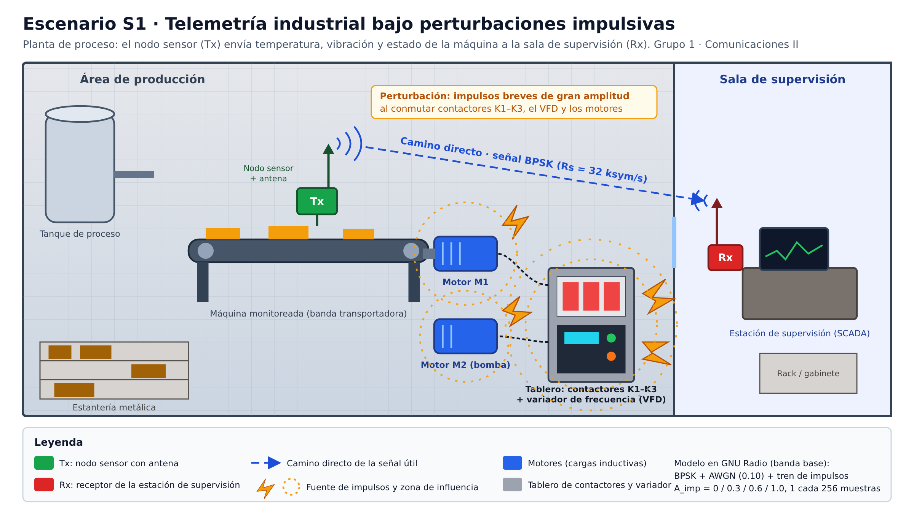

# Telemetría industrial bajo perturbaciones impulsivas — Comunicaciones II, Grupo 1

> **Blog del proyecto:** https://juliancamiloacevedosalamanca-ship-it.github.io/ComunicacionesII_Grupo01/
>
> **Informe IEEE:** [docs/informe_final.pdf](docs/informe_final.pdf) · **Video de socialización:** _(pegar aquí el enlace cuando esté listo)_

**Escenario:** S1 · Telemetría industrial bajo perturbaciones impulsivas
**Curso:** Comunicaciones II (27145) — UIS, 2026-2
**Integrantes:** Julian Camilo Acevedo Salamanca, Luigy Andrey Amado Durán, Juan Camilo Salazar Ariza
**Última actualización:** 24 de octubre de 2026

---

## Resumen

En una planta industrial, un nodo envía variables lentas (temperatura, vibración, estado de una máquina) hacia la estación de supervisión. Al conmutar, motores, contactores y variadores generan perturbaciones muy breves y de gran amplitud que afectan algunas muestras de la señal. En este proyecto modelamos ese fenómeno en banda base con GNU Radio: un enlace BPSK con AWGN fijo al que se le suma un tren periódico de impulsos controlados. Mantenemos Rs, SPS y fs fijos y solo cambiamos la amplitud del impulso, en cuatro pruebas (referencia, suave, media y fuerte). Los impulsos se ven claramente en la señal temporal y en la constelación, pero casi nada en la PSD, porque su potencia media (A²/256) es menor que la del AWGN.

---

## Imagen principal del escenario



Diagrama técnico del sistema: [figures/diagramas_tecnicos/diagrama_tecnico_sistema.png](figures/diagramas_tecnicos/diagrama_tecnico_sistema.png)

---

## Diseño técnico

| Parámetro | Valor | Cómo se obtiene |
|---|---|---|
| Modulación | BPSK, tabla `(-1+0j, 1+0j)` | M = 2 |
| Bits por símbolo | k = 1 | k = log2(M) |
| Tasa de símbolos | Rs = 32 ksym/s | valor de referencia del curso |
| Tasa de bits | Rb = 32 kb/s | Rb = Rs · k |
| Muestras por símbolo | SPS = 8 | valor de referencia del curso |
| Tasa de muestreo | fs = 256 kS/s | fs = Rs · SPS |
| Pulso | rectangular, `h = [1]*Sps` | GRC base |
| Ancho de banda | ≈ 64 kHz entre primeros nulos | ≈ 2Rs (con RRC β=0.35 sería ≈ 43.2 kHz) |
| Ruido de fondo | AWGN, `noise_amp = 0.10` (fijo) | igual en todas las pruebas |
| Perturbación | tren de impulsos: 1 impulso cada 256 muestras | 256 muestras = 32 símbolos = 1 ms |
| Variable del experimento | amplitud del impulso `A_imp` | única variable que cambia |

**¿Por qué BPSK?** El enlace es de baja velocidad, así que no hace falta más tasa de bits; importa que la señal siga siendo reconocible. Con la misma amplitud, BPSK deja los dos símbolos lo más separados posible (±1). Se descartó OOK/ASK porque lleva la información en la amplitud, que es justo lo que alteran los impulsos. Se descartaron QPSK y 16QAM porque aumentan Rb sin necesitarlo y reducen la separación entre símbolos.

---

## GRC

### Archivos

- `grc/archivos_originales_o_referencia/Modulaciones_basadas_en_constelaciones_AWGN.grc`: archivo original del curso, sin modificar.
- `grc/archivos_modificados/Enlace_Beta_Impulsivo_Grupo1.grc`: archivo principal del proyecto.

### Cambios respecto al GRC original

1. `tabla_de_verdad_constelacion`: de `(0+0j, 1+0j)` (OOK) a `(-1+0j, 1+0j)` (BPSK).
2. Nuevas variables:
   - `periodo_imp = 256`: un impulso cada 256 muestras.
   - `A_imp`: slider de 0 a 1.0, con paso 0.1. Es la variable del experimento.
3. Nuevo **Vector Source (Complex)** con `vector = [0j]*(periodo_imp-1) + [complex(A_imp, 0)]` y `Repeat = True`. Genera 255 ceros y un impulso de amplitud A_imp, que se repiten continuamente.
4. Nuevo **Add (Complex)** (`blocks_add_xx_1`). Entrada 0: salida del Add original (señal + AWGN). Entrada 1: el tren de impulsos.
5. Los tres QT GUI Sinks (constelación, PSD y tiempo) ahora se conectan a la salida del **segundo Add**, para que muestren señal + AWGN + impulsos.
6. Ajustes de visualización, sin efecto en la señal:
   - PSD con `average = 0.2`, para ver mejor el piso.
   - Sink de tiempo con eje Y de −2.5 a 2.5, para que los impulsos fuertes no se recorten.

### Cadena de bloques

```
Random Source → Pack K Bits → Packed to Unpacked → Chunks to Symbols (BPSK)
  → Interpolating FIR Filter (pulso rectangular, Sps=8) → Throttle
  → Add #1 (+ Noise Source, AWGN 0.10)
  → Add #2 (+ Vector Source, impulsos A_imp cada 256 muestras)
  → QT GUI: Constelación, PSD y Tiempo
```

### Cómo ejecutarlo

1. Abrir `Enlace_Beta_Impulsivo_Grupo1.grc` en GNU Radio Companion 3.10.
2. Ejecutar (F6). Se abre la ventana con los sliders `Amplitud de ruido AWGN` (dejar en 0.10) y `Amplitud del impulso A_imp`.
3. Para cada prueba, mover `A_imp` al valor de la tabla y tomar las capturas de tiempo, constelación y PSD.

> En Windows con configuración regional en español, los valores se escriben con coma (`0,3`). No usar la rueda del mouse encima de las gráficas, porque hace zoom; para bajar en la ventana, usar la barra de desplazamiento.

---

## Pruebas

| Prueba | Severidad | noise_amp | Período | A_imp | Objetivo |
|---|---|---|---|---|---|
| A | Referencia | 0.10 | 256 muestras | 0.0 | comportamiento base (solo AWGN) |
| B | Suave | 0.10 | 256 muestras | 0.3 | inicio de la degradación |
| C | Media (principal) | 0.10 | 256 muestras | 0.6 | condición principal de análisis |
| D | Fuerte | 0.10 | 256 muestras | 1.0 | condición de estrés |

La tabla completa, con la columna de observaciones para llenar, está en `data/tablas_de_pruebas/tabla_pruebas.csv`.

### Evidencias por prueba

Capturas tomadas en GNU Radio Companion 3.10.12 el 24 de octubre de 2026:
- `tiempo/tiempo_A.png` … `tiempo_D.png`: señal temporal (envolvente compleja, I y Q), ventana de 2048 muestras = 8 ms.
- `psd/psd_A.png` … `psd_D.png`: PSD (FFT de 1024 puntos, fs = 256 kS/s).
- `constelacion_o_fsk/constelacion_A.png` … `constelacion_D.png`: constelación (2048 muestras).
- `capturas_completas/ventana_prueba_A.png` … `D.png`: ventana completa con los valores de los sliders.
- `diagramas_tecnicos/GRC_modificado_Enlace_Beta_Impulsivo.png`: diagrama del GRC modificado.

---

## Resultados y análisis

| Prueba | A_imp | Señal temporal | Constelación | PSD |
|---|---|---|---|---|
| A | 0.0 | niveles ±1 con el ruido del AWGN; sin picos | dos nubes alrededor de −1 y +1 | lóbulo principal en 0 Hz, nulos en ±32, ±64, ±96 kHz |
| B | 0.3 | picos pequeños (≈1.3) cada 1 ms | unos pocos puntos sueltos hacia ≈ −0.7 y ≈ 1.3 | sin cambio apreciable |
| C | 0.6 | picos claros (≈1.6–1.7) cada 1 ms | puntos sueltos en ≈ −0.4 y ≈ 1.6 | sin cambio apreciable |
| D | 1.0 | picos de ≈2 cada 1 ms | puntos sueltos en ≈ 0 y ≈ 2 | sin cambio apreciable; nulos un poco menos profundos |

**1. ¿El impulso aparece claramente en el dominio del tiempo?** Sí. Es la evidencia más clara. En los 8 ms de la ventana aparecen 8 picos, uno cada 1 ms (256 muestras / 256 kS/s). Como el impulso es real (`A_imp + 0j`), solo aparece en la componente I y su altura crece con A_imp. En la prueba D llega a ≈2, el doble del nivel del símbolo.

**2. ¿Cómo cambia el piso o los componentes de la PSD?** Casi no cambia. La PSD de las cuatro pruebas tiene la misma forma de sinc² del pulso rectangular, con BW ≈ 64 kHz entre primeros nulos. La razón es que la potencia media del tren de impulsos es muy baja: A_imp²/256 ≈ 0.0004, 0.0014 y 0.0039 para B, C y D, frente a 0.01 del AWGN y 1 de la señal. Además, un impulso tiene espectro plano, así que esa potencia se reparte en toda la banda. Por eso la PSD, que es un promedio, no deja ver un fenómeno raro y de gran amplitud. Solo en D se nota que los nulos se llenan un poco.

**Constelación.** El AWGN abre cada símbolo en una nube alrededor de ±1. Los impulsos generan otra cosa: unos pocos puntos aislados, corridos exactamente +A_imp sobre el eje I (≈0.4 % de las muestras, 1 de cada 256). En la prueba D, los puntos que venían del símbolo −1 caen en 0, justo en el umbral de decisión de BPSK. Con impulsos un poco más fuertes, esos símbolos se decidirían mal.

**Diferencia entre AWGN e impulsos.** El AWGN afecta todas las muestras un poco. El ruido impulsivo afecta muy pocas muestras, pero mucho. Con potencias medias parecidas, el daño se concentra en símbolos puntuales. Por eso el ruido impulsivo se ve en el tiempo y en la constelación, pero no en la PSD.

**3. ¿BPSK y BFSK reaccionan igual?** No se evaluó en esta etapa. El grupo trabajó solo con BPSK.

---

## Conclusión principal

En el enlace BPSK de telemetría (Rs = 32 ksym/s, fs = 256 kS/s), el ruido impulsivo periódico se manifiesta como picos aislados en el tiempo y como símbolos sueltos desplazados +A_imp en la constelación. La PSD casi no cambia, porque la potencia media del tren de impulsos es pequeña. Con A_imp = 1.0, los símbolos afectados quedan sobre el umbral de decisión. Para este tipo de perturbación, la señal temporal y la constelación son mejores evidencias que la PSD.


---

## Estructura del repositorio

```
ComunicacionesII_Grupo01/
├── README.md
├── grc/
│   ├── archivos_originales_o_referencia/
│   └── archivos_modificados/
├── figures/
│   ├── escenario/
│   ├── psd/
│   ├── constelacion_o_fsk/
│   ├── tiempo/
│   ├── capturas_completas/
│   └── diagramas_tecnicos/
├── data/
│   └── tablas_de_pruebas/
├── docs/
│   ├── index.html          (blog, publicado con GitHub Pages)
│   ├── assets/             (imágenes del blog)
│   ├── informe_final.pdf
│   ├── informe_final.docx
│   ├── guion_video.md
│   ├── ficha_decision_tecnica.pdf
│   └── bitacora.md
└── referencias/
    └── fuentes_y_enlaces.md
```

---

## Referencias

[1] K. L. Blackard, T. S. Rappaport y C. W. Bostian, "Measurements and models of radio frequency impulsive noise for indoor wireless communications," *IEEE J. Sel. Areas Commun.*, vol. 11, no. 7, pp. 991–1001, 1993.
[2] D. Middleton, "Statistical-physical models of electromagnetic interference," *IEEE Trans. Electromagn. Compat.*, vol. EMC-19, no. 3, pp. 106–127, 1977.
[3] M. Zhan, Z. Pang, D. Dzung, K. Yu y M. Xiao, "Short-packet interleaver against impulse interference in practical industrial environments," arXiv:2203.00770, 2022.
[4] K. L. Blackard, "Measurements and models of radio frequency impulsive noise inside buildings," tesis de maestría, Virginia Tech, 1991.
[5] J. G. Proakis y M. Salehi, *Digital Communications*, 5.ª ed. McGraw-Hill, 2008.

Lista completa con enlaces: [referencias/fuentes_y_enlaces.md](referencias/fuentes_y_enlaces.md)
